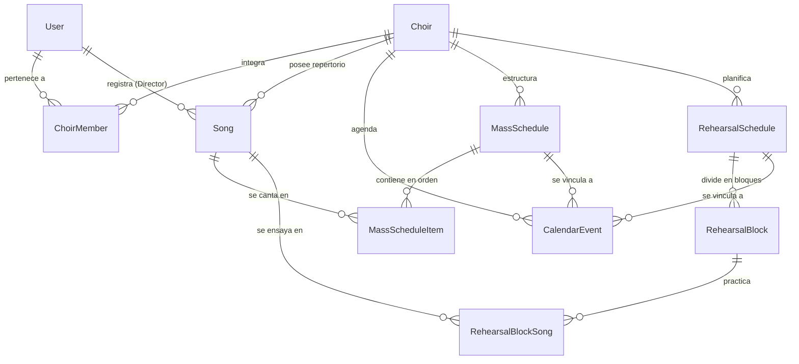

# Documentación Técnica y Funcional — Sistema Integral de Gestión Coral y Litúrgica (Versión 2.0 Completa)

## 1. Descripción General del Sistema
El **Sistema Integral de Gestión de Cantos, Calendario, Misas y Ensayos** es una aplicación web moderna, responsiva e intuitiva diseñada para organizar, clasificar y compartir el repertorio musical y la planificación operativa de coros parroquiales y comunitarios dentro de un entorno **100% cerrado bajo autenticación**.

El sistema implementa seis módulos integrados:
1. **Módulo de Autenticación Cerrada y Control de Acceso Basado en Roles (`Director` y `Miembro`)**.
2. **Módulo de Gestión, Clasificación Litúrgica y Búsqueda Libre de Cantos con Acordes Interactivos**.
3. **Módulo de Calendario Manipulable del Coro** (con soporte *Drag & Drop* para reprogramar eventos).
4. **Módulo de Cronograma de Misa** (estructuración del orden litúrgico con lectura continua o paso a paso de letras y acordes).
5. **Módulo de Cronograma de Ensayos** (planificación detallada por bloques de actividad, tiempos, objetivos y cantos vinculados).
6. **Módulo de Comunidad y Miembros del Coro**.

---

## 2. Objetivos del Sistema
- **Seguridad y Privacidad**: Garantizar que el acceso al sistema requiera inicio de sesión obligatorio (Login), estableciendo a los miembros autenticados de los coros como el nivel base de acceso ("público interno").
- **Gestión por parte del Director**: Proveer un apartado exclusivo para que el Director del coro pueda registrar y administrar cantos (letra, acordes y clasificación), decidiendo si cada canto permanece **Privado** para su coro o **Público** para los demás coros registrados.
- **Clasificación Litúrgica Estandarizada**: Organizar el repertorio según el **Tiempo en el Año** (*Ordinario, Cuaresma, Pascua, Adviento, Navidad*) y su **Apropiación para la Misa** (*Litúrgico, No litúrgico*).
- **Búsqueda Libre e Intuitiva**: Permitir a directores y miembros buscar cantos de cualquier tipo de forma rápida y visualizar su letra y acordes con transposición de tono en tiempo real.

---

## 3. Modelo de Roles y Seguridad (Sistema Cerrado)

El sistema no permite el acceso a visitantes anónimos. Toda interacción requiere una sesión activa validada mediante tokens firmados (JWT).

| Rol en el Sistema | Nivel de Acceso | Permisos y Capacidades |
| :--- | :--- | :--- |
| **Director (`DIRECTOR`)** | Administración de Coro | - Iniciar sesión en la plataforma.<br>- Acceder al apartado de **Subida y Edición de Cantos**.<br>- Clasificar cada canto por Tiempo en el Año y por categoría Litúrgico / No litúrgico.<br>- Definir si un canto de su coro es **Privado** (solo visible para su coro) o **Público** (visible para los demás coros autenticados).<br>- Utilizar el buscador libre y el visor interactivo de cantos. |
| **Miembro (`MEMBER`)** | Base ("Público Autenticado") | - Iniciar sesión en la plataforma.<br>- Buscar y consultar libremente todos los cantos privados de su propio coro.<br>- Buscar y consultar todos los cantos que directores de otros coros hayan marcado como **Públicos**.<br>- Visualizar la letra y acordes de los cantos y ajustar el tono de lectura en su pantalla. |

---

## 4. Especificación Funcional de Módulos

### 4.1. Módulo de Autenticación (Login y Registro)
- **Inicio de Sesión**: Validación de credenciales (correo electrónico y contraseña encriptada con `bcrypt`).
- **Registro por Rol**: Permite crear un nuevo coro como `DIRECTOR` o unirse a un coro existente mediante su código de invitación como `MEMBER`.
- **Protección de Rutas**: Bloqueo automático de cualquier vista o endpoint si el usuario no cuenta con una sesión activa.

### 4.2. Apartado de Subida de Cantos (Exclusivo Director)
Formulario intuitivo con previsualización en tiempo real que permite al Director registrar:
- **Datos generales**: Título del canto, Autor / Comunidad y Tonalidad base (ej. `Do`, `Sol`, `Lam`).
- **Letra y Acordes**: Editor en formato estructurado (*ChordPro* `[Do]Letra`), que alinea automáticamente cada acorde sobre la sílaba correspondiente.
- **División por Tiempo en el Año** *(presentada estrictamente en este orden)*:
  1. **Ordinario**
  2. **Cuaresma**
  3. **Pascua**
  4. **Adviento**
  5. **Navidad**
- **División por Apropiación para una Misa**:
  - **Litúrgico**
  - **No litúrgico**
- **Control de Visibilidad Entre Coros**:
  - **Privado**: Visible únicamente para el director y los miembros de su propio coro.
  - **Público**: Visible para los directores y miembros de todos los coros registrados en el sistema.

### 4.3. Buscador Libre y Visor de Cantos
- **Búsqueda por texto libre**: Filtra instantáneamente por coincidencias en el título, autor o contenido de la letra.
- **Filtros combinables**:
  - **Por Tiempo en el Año**: Botones en el orden estricto *Ordinario → Cuaresma → Pascua → Adviento → Navidad*.
  - **Por Apropiación para Misa**: *Todos | Litúrgico | No litúrgico*.
  - **Por Alcance**: *Todos | Mi Coro | Otros Coros (Públicos)*.
- **Visor Interactivo de Letra y Acordes**:
  - Muestra la letra clara con los acordes posicionados en la parte superior de cada sílaba.
  - Incluye botones de **Transposición de Tono (`-1` / `+1` semitono)**, cambio entre notación Latina (`Do, Re, Mi`) y Americana (`C, D, E`), ajuste de tamaño de fuente y **Modo Atril Oscuro**.

### 4.4. Calendario Manipulable del Coro
- **Vista Mensual Interactiva y Agenda**: Muestra todos los eventos del coro clasificados en *Santa Misa*, *Ensayo del Coro* y *Evento Importante*.
- **Manipulación Interactiva**: El Director puede arrastrar y soltar (*Drag & Drop*) cualquier evento sobre otro día del calendario (o usar los botones `-1 Día` / `+1 Día`) para reprogramar fechas instantáneamente.
- **Conexión Directa**: Al seleccionar un evento de Misa o Ensayo, un botón directo abre su respectivo Cronograma de Misa o Cronograma de Ensayo.

### 4.5. Cronograma de Misa y Modo Atril en Vivo
- **Estructurador Litúrgico**: Permite armar el orden exacto de los cantos de una Misa (*Entrada, Señor Ten Piedad, Gloria, Salmo, Aleluya, Ofertorio, Santo, Cordero de Dios, Comunión, Salida*), reordenarlos, asignar el **tono específico** en que se tocará cada canto en esa misa y añadir notas del director.
- **Alertas Litúrgicas**: Si el tiempo seleccionado es *Cuaresma* o *Adviento*, muestra un aviso pastoral sobre la omisión del Gloria y el uso de la aclamación.
- **Modo Atril (Paso a Paso o Continuo)**: Permite recorrer todos los cantos de la Misa en orden viendo su letra y acordes automáticamente transportados al tono definido para esa celebración.

### 4.6. Cronograma de Ensayos ("Saber qué se hará a cabalidad")
- **Planificación por Bloques**: Divide el ensayo en bloques secuenciales (*Oración, Vocalización, Práctica de Canto, Repaso de Misa, Avisos*) con duración en minutos y cálculo automático del tiempo total.
- **Instrucciones Exhaustivas y Checklist**: Cada bloque detalla qué se trabajará a cabalidad, permite marcar bloques completados con barra de porcentaje de avance, y vincula los cantos a practicar para abrir su letra y acordes en 1 clic.

---

## 5. Arquitectura y Stack Tecnológico

### 5.1. Tecnologías Utilizadas
- **Infraestructura**: **Docker & Docker Compose** (Contenedores aislados para Base de Datos, Backend API y Frontend Web)
- **Runtime & Gestor de Paquetes**: **Bun**
- **Frontend**: **React 19 + TypeScript + Vite + Tailwind CSS**
- **Backend (API REST)**: **ElysiaJS** sobre Bun (con validación estricta de esquemas y Swagger/OpenAPI)
- **ORM y Base de Datos**: **Prisma ORM** conectado a **PostgreSQL 16**
- **Autenticación**: **JWT (HMAC-SHA256) + Bcrypt Password Hashing**

### 5.2. Estructura del Monorepo
```text
cantos/
├── docker-compose.yml              # Orquestación Full Docker (db + api + web)
├── apps/
│   ├── web/                        # Aplicación Cliente (React + TypeScript + Tailwind)
│   │   ├── Dockerfile
│   │   └── src/
│   │       ├── components/         # ChordSheetViewer, LoginView, SongFormModal
│   │       ├── lib/                # Cliente HTTP tipado y gestión de sesión
│   │       └── App.tsx             # Buscador libre, filtros litúrgicos y visor
│   │
│   └── api/                        # Servidor Backend (Bun + Elysia + Prisma)
│       ├── Dockerfile
│       ├── prisma/
│       │   ├── schema.prisma       # Esquema relacional PostgreSQL
│       │   └── seed.ts             # Datos iniciales de demostración
│       └── src/
│           ├── auth.ts             # Firma y verificación de tokens JWT
│           └── index.ts            # Endpoints REST y reglas de negocio
│
└── packages/
    └── shared/                     # Constantes litúrgicas y motor de acordes ChordPro
```

---

## 6. Modelo de Base de Datos Completo (Esquema Relacional)



---

## 7. Endpoints de la API REST (Sistema Completo)

| Método | Ruta | Rol Requerido | Descripción |
| :--- | :--- | :--- | :--- |
| `POST` | `/api/auth/login` | Credenciales | Autentica al usuario y devuelve su JWT, coro y rol (`DIRECTOR` o `MEMBER`). |
| `POST` | `/api/auth/register` | Registro | Crea un usuario y su coro (`DIRECTOR`) o lo une por código (`MEMBER`). |
| `GET` | `/api/auth/me` | `DIRECTOR` o `MEMBER` | Devuelve el perfil del usuario autenticado y datos de su coro. |
| `GET` | `/api/songs` | `DIRECTOR` o `MEMBER` | Buscador libre de cantos (`q`, `season`, `suitability`, `scope`). Aplica filtro estricto de visibilidad por coro. |
| `POST` | `/api/songs` | **Solo `DIRECTOR`** | Registra un nuevo canto en el coro del director definiendo `isPublic`. |
| `PUT` | `/api/songs/:id` | **Solo `DIRECTOR` (Dueño)** | Actualiza los datos, acordes o visibilidad (`isPublic`) de un canto de su coro. |
| `DELETE` | `/api/songs/:id` | **Solo `DIRECTOR` (Dueño)** | Elimina un canto perteneciente al coro del director. |
| `GET` | `/api/calendar` | `DIRECTOR` o `MEMBER` | Obtiene todos los eventos del calendario del coro. |
| `POST` | `/api/calendar` | **Solo `DIRECTOR`** | Crea un nuevo evento importante, misa o ensayo en el calendario. |
| `PATCH` | `/api/calendar/:id/move` | **Solo `DIRECTOR`** | Reprograma la fecha de un evento (usado por Drag & Drop). |
| `DELETE` | `/api/calendar/:id` | **Solo `DIRECTOR`** | Elimina un evento del calendario. |
| `GET` | `/api/mass-schedules` | `DIRECTOR` o `MEMBER` | Lista los cronogramas de misa con sus cantos en orden, letras y acordes. |
| `POST` | `/api/mass-schedules` | **Solo `DIRECTOR`** | Crea un cronograma de misa y lo agenda automáticamente en el calendario. |
| `PUT` | `/api/mass-schedules/:id` | **Solo `DIRECTOR`** | Actualiza el orden, tonos y cantos de un cronograma de misa. |
| `GET` | `/api/rehearsal-schedules` | `DIRECTOR` o `MEMBER` | Lista los cronogramas de ensayo con sus bloques detallados y cantos. |
| `POST` | `/api/rehearsal-schedules` | **Solo `DIRECTOR`** | Crea un cronograma de ensayo y lo agenda en el calendario. |
| `PATCH` | `/api/rehearsal-schedules/:id/blocks/:blockId/toggle` | **Solo `DIRECTOR`** | Marca o desmarca un bloque del ensayo como completado. |
| `GET` | `/api/choir/members` | `DIRECTOR` o `MEMBER` | Lista los integrantes del coro, sus roles e instrumentos y código de invitación. |
