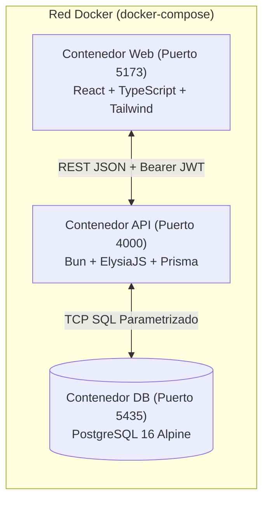

# 🎓 Guía de Estudio para la Defensa del Sistema (Versión 1.0)

Esta guía está preparada específicamente para defender la **Primera Entrega (Versión 1.0: Autenticación Cerrada y Módulo de Cantos)** ante las autoridades evaluadoras, cubriendo los **4 pilares exigidos**:
1. **Funcionalidad** (Qué hace, reglas de negocio y seguridad de roles)
2. **Diseño** (UI/UX ergonómico para músicos y Arquitectura en 3 capas)
3. **Estructura** (Organización Monorepo y contenedores Docker)
4. **Implementación** (Justificación del stack, consultas Prisma y algoritmo de acordes)

---

## 1. PILAR DE FUNCIONALIDAD (El "Qué" y el "Para Qué")

### 1.1. Problema que resuelve
Los coros litúrgicos suelen manejar sus cantos en hojas sueltas, PDFs desordenados o chats, provocando tres problemas graves:
1. Dificultad para encontrar cantos apropiados para cada **Tiempo Litúrgico** o distinguir cuáles son estrictamente **Litúrgicos** frente a los **No litúrgicos**.
2. Letras con acordes desalineados que no permiten cambiar de tono rápidamente cuando cambia la voz que canta.
3. Falta de un espacio seguro donde el Director controle el repertorio oficial de su coro y pueda compartir cantos con otros coros sin perder el orden.

### 1.2. Modelo de Acceso Cerrado bajo Autenticación (Punto Clave)
> **Cómo explicarlo al jurado:**
> *"Nuestro sistema es 100% cerrado bajo autenticación. Ningún visitante anónimo de internet tiene acceso. El nivel más bajo de acceso —lo que dentro de nuestra plataforma denominamos nivel 'Público'— son los **Miembros autenticados de los coros**."*

- **Rol `DIRECTOR` (Director de Coro)**:
  - Tiene el apartado exclusivo para **subir, editar y eliminar cantos** de su coro.
  - En cada canto decide mediante un selector si el canto es:
    - **Privado (`isPublic: false`)**: Solo visible para el director y los miembros de su propio coro.
    - **Público (`isPublic: true`)**: Visible en el buscador para todos los directores y miembros autenticados de los demás coros.
- **Rol `MEMBER` (Miembro del Coro)**:
  - Nivel base del sistema una vez iniciada la sesión.
  - Puede buscar libremente y leer todos los cantos privados de su propio coro más todos los cantos marcados como **Públicos** por otros coros, pero **no puede subir, modificar ni borrar cantos**.

### 1.3. División y Clasificación de los Cantos
El sistema implementa estrictamente las dos divisiones solicitadas:
1. **Por Tiempo en el Año** *(en este orden exacto en la base de datos y en toda la interfaz)*:
   1. **Ordinario**
   2. **Cuaresma**
   3. **Pascua**
   4. **Adviento**
   5. **Navidad**
2. **Por Apropiación para una Misa**:
   - **Litúrgico** (Apropiado para la liturgia de la Misa)
   - **No litúrgico** (Cantos de animación, adoración, retiros, etc.)

---

## 2. PILAR DE DISEÑO (UI/UX y Arquitectura)

### 2.1. Diseño Visual e Intuitivo (UI/UX)
- **Semántica de Colores Litúrgicos**: Cada tiempo en el año tiene su código visual propio (Verde para Ordinario, Morado para Cuaresma, Dorado para Pascua, Índigo/Morado para Adviento, Rosa/Rojo cálido para Navidad).
- **Jerarquía de Lectura Musical**: Los acordes se renderizan en una fila superior con fuente monoespaciada resaltada exactamente sobre la sílaba donde cambia el acorde.
- **Modo Atril**: Permite alternar a fondo oscuro de alto contraste, ocultar acordes (para cantantes que no tocan instrumento), agrandar la letra (`A-` / `A+`) y cambiar entre notación Latina (`Do, Re, Mi`) y Americana (`C, D, E`).
- **Estudio del Director con Vista Previa en Vivo**: Al subir un canto, el director ve en tiempo real a la derecha cómo quedan alineados los acordes mientras escribe a la izquierda.

### 2.2. Arquitectura en 3 Capas Contenedorizada (Full Docker)


---

## 3. PILAR DE ESTRUCTURA (Organización del Código)

El proyecto está organizado como un **Monorepo con Bun Workspaces**:
- [docker-compose.yml](docker-compose.yml): Orquesta los 3 contenedores (`db`, `api`, `web`) con chequeos de salud (`healthcheck`) y volúmenes persistentes.
- [packages/shared/src/index.ts](packages/shared/src/index.ts): Paquete compartido entre el Frontend y el Backend. Contiene la lista ordenada de tiempos litúrgicos (`LITURGICAL_SEASONS_ORDERED`) y el motor matemático de parseo y transposición de acordes (`parseChordProText`, `transposeSingleChord`).
- [apps/api/prisma/schema.prisma](apps/api/prisma/schema.prisma): Define los modelos relacionales (`User`, `Choir`, `ChoirMember`, `Song`) y los enums (`Role`, `LiturgicalSeason`, `MassSuitability`).
- [apps/api/src/index.ts](apps/api/src/index.ts): Servidor ElysiaJS con los endpoints de autenticación y CRUD/búsqueda de cantos.
- [apps/web/src/App.tsx](apps/web/src/App.tsx): Interfaz principal con buscador libre, filtros combinables y visor de cantos.

---

## 4. PILAR DE IMPLEMENTACIÓN (Código y Decisiones Técnicas)

### 4.1. ¿Por qué elegimos este Stack Tecnológico?
- **Bun + ElysiaJS**: Ejecución nativa de TypeScript con altísimo rendimiento, validación automática de esquemas de entrada (`t.Object`) y generación automática de documentación Swagger/OpenAPI.
- **Prisma + PostgreSQL**: Garantiza integridad referencial (llaves foráneas entre Coros, Usuarios y Cantos), soporta arreglos nativos de enums en PostgreSQL (`liturgicalSeasons LiturgicalSeason[]`) para que un canto pueda servir en más de un tiempo litúrgico, y previene inyección SQL.
- **React + TypeScript + Tailwind CSS**: Permite que el buscador libre, los filtros y el transpositor de acordes respondan en milisegundos sin recargar el navegador.
- **Full Docker**: Asegura que el sistema funcione exactamente igual en cualquier computadora con un solo comando (`docker compose up --build -d`), incluyendo la base de datos PostgreSQL.

### 4.2. ¿Cómo garantiza el Backend que un Miembro o Director no vea cantos privados de otro coro?
En [apps/api/src/index.ts](apps/api/src/index.ts), el endpoint `GET /api/songs` extrae el `choirId` del token JWT del usuario autenticado e inyecta obligatoriamente la condición de visibilidad en Prisma:
```ts
const visibilityWhere =
  scope === 'MY_CHOIR'
    ? { choirId: authUser.choirId }
    : scope === 'PUBLIC_OTHER'
    ? { isPublic: true, NOT: { choirId: authUser.choirId } }
    : {
        OR: [{ choirId: authUser.choirId }, { isPublic: true }],
      };
```
Así, la base de datos **jamás devuelve** un canto con `isPublic: false` que pertenezca a otro coro.

### 4.3. ¿Cómo funciona la protección del Rol Director al subir cantos?
En dos capas:
1. **En el Frontend ([apps/web/src/App.tsx](apps/web/src/App.tsx))**: El botón *"Subir Canto"* y los botones de *"Editar / Cambiar Visibilidad / Eliminar"* solo se renderizan si `user.role === 'DIRECTOR'`.
2. **En el Backend ([apps/api/src/index.ts](apps/api/src/index.ts))**: En `POST /api/songs`, `PUT /api/songs/:id` y `DELETE /api/songs/:id`, el servidor verifica `if (authUser.role !== 'DIRECTOR')` y además comprueba que `existing.choirId === authUser.choirId`, devolviendo `HTTP 403 Forbidden` si un miembro intenta enviar una petición directa.

### 4.4. ¿Cómo funciona el algoritmo de acordes y transposición?
En [packages/shared/src/index.ts](packages/shared/src/index.ts):
1. Las letras se guardan con marcas de acorde entre corchetes: `[Re]Juntos como her[La]manos`.
2. Una expresión regular (`/\[([^\]]+)\]([^\[]*)/g`) separa cada fragmento en `{ chord, lyric }`.
3. Para transportar el tono (`+1` o `-1`), `transposeSingleChord` convierte la raíz del acorde a su índice numérico en la escala cromática de 12 semitonos (`0` = `Do/C` ... `11` = `Si/B`), aplica aritmética modular `((baseIndex + semitones) % 12 + 12) % 12` y devuelve el nuevo acorde conservando su sufijo (`m`, `7`, `#`, etc.).

---

## 5. GUION PASO A PASO PARA LA DEMOSTRACIÓN EN VIVO

1. **Mostrar el Login Cerrado**:
   - Abre `http://localhost:5173`. Explica que nadie puede ver ningún canto sin autenticarse.
2. **Entrar como Director del Coro Santa Cecilia**:
   - Haz clic en el acceso rápido **"DIRECTOR — Coro Santa Cecilia"**.
   - Muestra en la barra superior el badge **"Rol: Director del Coro"** y el botón **"Subir Canto"**.
   - Abre **"Subir Canto"** y enseña el editor con vista previa en vivo, el orden exacto de los tiempos (*1. Ordinario, 2. Cuaresma, 3. Pascua, 4. Adviento, 5. Navidad*), la opción *Litúrgico / No litúrgico* y el selector **Público vs Privado**.
3. **Probar el Buscador Libre y el Visor de Acordes**:
   - Filtra por **Cuaresma**, luego por **Pascua**, luego por **No litúrgico**.
   - Selecciona un canto y presiona los botones `-` y `+` de **Tono** para mostrar cómo todos los acordes cambian en tiempo real sobre las sílabas. Prueba también el botón **Notación: C, D, E** y el **Modo Atril**.
4. **Demostrar la Privacidad entre Coros y el Rol Miembro**:
   - Observa que en el Coro Santa Cecilia existe el canto *"Pueblo de Reyes"* marcado como **Privado de mi coro**, y *"Juntos como Hermanos"* marcado como **Público**.
   - Cierra sesión (`Salir`) y entra como **"MIEMBRO — Coro San Miguel (Otro Coro)"**.
   - Muestra que:
     1. Ya **no aparece** el botón de *"Subir Canto"* ni los botones de editar/eliminar (porque es `Miembro`).
     2. Al filtrar por **"Otros Coros"**, puede ver *"Juntos como Hermanos"* (porque el Director de Santa Cecilia lo hizo **Público**), pero **no puede ver** *"Pueblo de Reyes"* (porque es **Privado** de Santa Cecilia).
