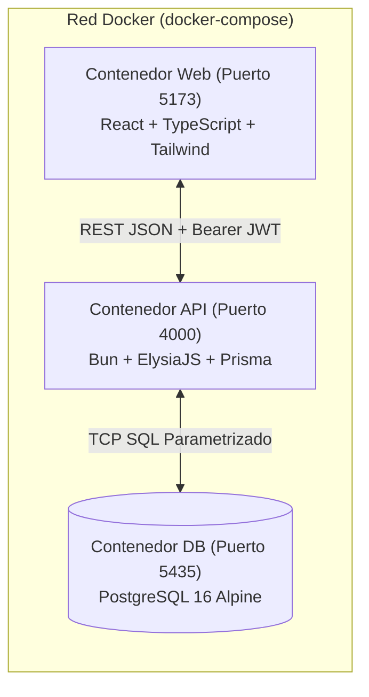

# 🎓 Guía de Estudio para la Defensa del Sistema Completo (Versión 2.0)

Esta guía está preparada específicamente para defender el **Sistema Completo (Autenticación Cerrada, Módulo de Cantos, Calendario Manipulable, Cronograma de Misa y Cronograma de Ensayos)** ante las autoridades evaluadoras, cubriendo los **4 pilares exigidos**:
1. **Funcionalidad** (Qué hace, reglas de negocio, seguridad de roles y planificación litúrgica/operativa)
2. **Diseño** (UI/UX ergonómico para músicos, Modo Atril y Arquitectura en 3 capas)
3. **Estructura** (Organización Monorepo y contenedores Docker)
4. **Implementación** (Justificación del stack, consultas Prisma, relaciones SQL y algoritmo de acordes)

---

## 1. PILAR DE FUNCIONALIDAD (El "Qué" y el "Para Qué")

### 1.1. Problema que resuelve
Los coros litúrgicos suelen manejar sus cantos en hojas sueltas, PDFs desordenados o chats, provocando tres problemas graves:
1. Dificultad para encontrar cantos apropiados para cada **Tiempo Litúrgico** o distinguir cuáles son estrictamente **Litúrgicos** frente a los **No litúrgicos**.
2. Letras con acordes desalineados que no permiten cambiar de tono rápidamente cuando cambia la voz que canta.
3. Falta de un espacio seguro donde el Director controle el repertorio oficial de su coro y pueda compartir cantos con otros coros sin perder el orden.

### 1.2. Modelo de Acceso Cerrado bajo Autenticación (Punto Clave)
> **Cómo explicarlo al jurado:**
> *"Nuestro sistema es 100% cerrado bajo autenticación. Ningún visitante anónimo de internet tiene acceso. El nivel más bajo de acceso —lo que dentro de nuestra plataforma denominamos nivel 'Público'— son los **Miembros autenticados de los coros**."*

- **Rol `DIRECTOR` (Director de Coro)**:
  - Tiene el apartado exclusivo para **subir, editar y eliminar cantos** de su coro.
  - En cada canto decide mediante un selector si el canto es:
    - **Privado (`isPublic: false`)**: Solo visible para el director y los miembros de su propio coro.
    - **Público (`isPublic: true`)**: Visible en el buscador para todos los directores y miembros autenticados de los demás coros.
- **Rol `MEMBER` (Miembro del Coro)**:
  - Nivel base del sistema una vez iniciada la sesión.
  - Puede buscar libremente y leer todos los cantos privados de su propio coro más todos los cantos marcados como **Públicos** por otros coros, pero **no puede subir, modificar ni borrar cantos**.

### 1.3. División y Clasificación de los Cantos
El sistema implementa estrictamente las dos divisiones solicitadas:
1. **Por Tiempo en el Año** *(en este orden exacto en la base de datos y en toda la interfaz)*:
   1. **Ordinario**
   2. **Cuaresma**
   3. **Pascua**
   4. **Adviento**
   5. **Navidad**
2. **Por Apropiación para una Misa**:
   - **Litúrgico** (Apropiado para la liturgia de la Misa)
   - **No litúrgico** (Cantos de animación, adoración, retiros, etc.)

### 1.4. Planificación Operativa: Calendario, Cronograma de Misa y Cronograma de Ensayos
1. **Calendario Manipulable del Coro**:
   - Permite al Director agendar *Santas Misas*, *Ensayos* y *Eventos Importantes*, y reprogramarlos arrastrándolos con el mouse (**Drag & Drop**) a cualquier otro día o con los botones rápidos `-1 Día / +1 Día`.
   - Está conectado relacionalmente con los cronogramas: al hacer clic en un evento de Misa o Ensayo, lleva en 1 clic a su cronograma completo.
2. **Cronograma de Misa y Modo Atril**:
   - Permite estructurar el orden litúrgico de los cantos de una celebración (*Entrada, Señor Ten Piedad, Gloria, Ofertorio, Santo, Cordero, Comunión, Salida*), definiendo el **tono específico (`targetKey`)** para esa Misa.
   - Incluye **Modo Atril Paso a Paso** y **Vista Continua**, donde todo el coro lee las letras y acordes en orden, ya transportados automáticamente al tono acordado para esa misa.
3. **Cronograma de Ensayos ("Saber qué se hará a cabalidad")**:
   - Divide cada ensayo en **bloques ordenados por actividad y duración** (*Oración, Vocalización, Práctica de Canto, Repaso de Misa, Avisos*), mostrando el objetivo general, el tiempo total, las instrucciones técnicas detalladas del director, los cantos vinculados (con apertura inmediata de su letra y acordes) y un checklist de progreso en tiempo real.

---

## 2. PILAR DE DISEÑO (UI/UX y Arquitectura)

### 2.1. Diseño Visual e Intuitivo (UI/UX)
- **Semántica de Colores Litúrgicos**: Cada tiempo en el año tiene su código visual propio (Verde para Ordinario, Morado para Cuaresma, Dorado para Pascua, Índigo/Morado para Adviento, Rosa/Rojo cálido para Navidad).
- **Jerarquía de Lectura Musical**: Los acordes se renderizan en una fila superior con fuente monoespaciada resaltada exactamente sobre la sílaba donde cambia el acorde.
- **Modo Atril**: Permite alternar a fondo oscuro de alto contraste, ocultar acordes (para cantantes que no tocan instrumento), agrandar la letra (`A-` / `A+`) y cambiar entre notación Latina (`Do, Re, Mi`) y Americana (`C, D, E`).
- **Estudio del Director con Vista Previa en Vivo**: Al subir un canto, el director ve en tiempo real a la derecha cómo quedan alineados los acordes mientras escribe a la izquierda.

### 2.2. Arquitectura en 3 Capas Contenedorizada (Full Docker)


---

## 3. PILAR DE ESTRUCTURA (Organización del Código)

El proyecto está organizado como un **Monorepo con Bun Workspaces**:
- [docker-compose.yml](docker-compose.yml): Orquesta los 3 contenedores (`db`, `api`, `web`) con chequeos de salud (`healthcheck`) y volúmenes persistentes.
- [packages/shared/src/index.ts](packages/shared/src/index.ts): Paquete compartido entre el Frontend y el Backend. Contiene la lista ordenada de tiempos litúrgicos (`LITURGICAL_SEASONS_ORDERED`) y el motor matemático de parseo y transposición de acordes (`parseChordProText`, `transposeSingleChord`).
- [apps/api/prisma/schema.prisma](apps/api/prisma/schema.prisma): Define los modelos relacionales (`User`, `Choir`, `ChoirMember`, `Song`) y los enums (`Role`, `LiturgicalSeason`, `MassSuitability`).
- [apps/api/src/index.ts](apps/api/src/index.ts): Servidor ElysiaJS con los endpoints de autenticación y CRUD/búsqueda de cantos.
- [apps/web/src/App.tsx](apps/web/src/App.tsx): Interfaz principal con buscador libre, filtros combinables y visor de cantos.

---

## 4. PILAR DE IMPLEMENTACIÓN (Código y Decisiones Técnicas)

### 4.1. ¿Por qué elegimos este Stack Tecnológico?
- **Bun + ElysiaJS**: Ejecución nativa de TypeScript con altísimo rendimiento, validación automática de esquemas de entrada (`t.Object`) y generación automática de documentación Swagger/OpenAPI.
- **Prisma + PostgreSQL**: Garantiza integridad referencial (llaves foráneas entre Coros, Usuarios y Cantos), soporta arreglos nativos de enums en PostgreSQL (`liturgicalSeasons LiturgicalSeason[]`) para que un canto pueda servir en más de un tiempo litúrgico, y previene inyección SQL.
- **React + TypeScript + Tailwind CSS**: Permite que el buscador libre, los filtros y el transpositor de acordes respondan en milisegundos sin recargar el navegador.
- **Full Docker**: Asegura que el sistema funcione exactamente igual en cualquier computadora con un solo comando (`docker compose up --build -d`), incluyendo la base de datos PostgreSQL.

### 4.2. ¿Cómo garantiza el Backend que un Miembro o Director no vea cantos privados de otro coro?
En [apps/api/src/index.ts](apps/api/src/index.ts), el endpoint `GET /api/songs` extrae el `choirId` del token JWT del usuario autenticado e inyecta obligatoriamente la condición de visibilidad en Prisma:
```ts
const visibilityWhere =
  scope === 'MY_CHOIR'
    ? { choirId: authUser.choirId }
    : scope === 'PUBLIC_OTHER'
    ? { isPublic: true, NOT: { choirId: authUser.choirId } }
    : {
        OR: [{ choirId: authUser.choirId }, { isPublic: true }],
      };
```
Así, la base de datos **jamás devuelve** un canto con `isPublic: false` que pertenezca a otro coro.

### 4.3. ¿Cómo funciona la protección del Rol Director al subir cantos?
En dos capas:
1. **En el Frontend ([apps/web/src/App.tsx](apps/web/src/App.tsx))**: El botón *"Subir Canto"* y los botones de *"Editar / Cambiar Visibilidad / Eliminar"* solo se renderizan si `user.role === 'DIRECTOR'`.
2. **En el Backend ([apps/api/src/index.ts](apps/api/src/index.ts))**: En `POST /api/songs`, `PUT /api/songs/:id` y `DELETE /api/songs/:id`, el servidor verifica `if (authUser.role !== 'DIRECTOR')` y además comprueba que `existing.choirId === authUser.choirId`, devolviendo `HTTP 403 Forbidden` si un miembro intenta enviar una petición directa.

### 4.4. ¿Cómo funciona el algoritmo de acordes y transposición automática en Misas?
En [packages/shared/src/index.ts](packages/shared/src/index.ts):
1. Las letras se guardan con marcas de acorde entre corchetes: `[Re]Juntos como her[La]manos`.
2. Una expresión regular (`/\[([^\]]+)\]([^\[]*)/g`) separa cada fragmento en `{ chord, lyric }`.
3. Para transportar el tono (`+1` o `-1`), `transposeSingleChord` convierte la raíz del acorde a su índice numérico en la escala cromática de 12 semitonos (`0` = `Do/C` ... `11` = `Si/B`), aplica aritmética modular `((baseIndex + semitones) % 12 + 12) % 12` y devuelve el nuevo acorde conservando su sufijo (`m`, `7`, `#`, etc.).
4. En el **Cronograma de Misa**, si un canto está guardado en `Do` pero el Director define que en esa Misa se cantará en `Re` (`targetKey`), la función `getSemitoneDiffBetweenKeys('Do', 'Re')` calcula automáticamente la diferencia (`+2` semitonos) y renderiza toda la canción en `Re` sin alterar el canto original de la base de datos.

### 4.5. Diseño Relacional de Calendario, Misas y Ensayos en PostgreSQL
En [apps/api/prisma/schema.prisma](apps/api/prisma/schema.prisma):
- **`MassSchedule` (1) ↔ (N) `MassScheduleItem` (N) ↔ (1) `Song`**: Permite reutilizar cualquier canto (del coro o público de otro coro) en múltiples misas, manteniendo un `sortOrder` (orden litúrgico) y un `targetKey` independiente por cada misa.
- **`RehearsalSchedule` (1) ↔ (N) `RehearsalBlock` (1) ↔ (N) `RehearsalBlockSong` (N) ↔ (1) `Song`**: Modela cada bloque de tiempo del ensayo con su duración (`durationMinutes`), estado (`isCompleted`) y tabla pivote hacia los cantos que se practicarán en ese bloque.
- **`CalendarEvent`**: Se vincula opcionalmente mediante llaves foráneas (`massScheduleId`, `rehearsalScheduleId`) para que al crear un Cronograma de Misa o de Ensayo, quede agendado automáticamente en el calendario del coro.

---

## 5. GUION PASO A PASO PARA LA DEMOSTRACIÓN EN VIVO (SISTEMA COMPLETO)

1. **Mostrar el Login Cerrado**:
   - Abre `http://localhost:5173`. Explica que el sistema es 100% cerrado bajo autenticación y que el nivel base ("público") son los miembros autenticados de los coros.
2. **Módulo 1 y 2 — Buscador Libre y Subida de Cantos del Director**:
   - Entra con **"DIRECTOR — Coro Santa Cecilia"**.
   - Muestra el buscador libre, el filtro por Tiempo en el Año en el orden exacto (*1. Ordinario, 2. Cuaresma, 3. Pascua, 4. Adviento, 5. Navidad*), el filtro *Litúrgico / No litúrgico*, el transpositor de acordes (`-1` / `+1`) y el formulario **"Subir Canto"** con vista previa en vivo y selector **Público vs Privado**.
3. **Módulo 3 — Calendario Manipulable del Coro**:
   - Abre la pestaña **"Calendario Manipulable"**.
   - Arrastra un evento con el mouse (*Drag & Drop*) a otro día del mes o usa los botones `-1 Día / +1 Día` para demostrar que es manipulable en tiempo real.
   - Haz clic en el evento *"Misa Dominical Solemne"* y presiona **"Ver Cronograma de Misa"**.
4. **Módulo 4 — Cronograma de Misa y Modo Atril**:
   - Muestra cómo está estructurado el orden de la Misa (*1. Entrada, 2. Señor Ten Piedad, 3. Gloria, 4. Ofertorio, 5. Santo, 6. Cordero, 7. Comunión, 8. Salida*).
   - Cambia a **"Atril Paso a Paso"** o **"Vista Continua (Toda la Misa)"** para mostrar cómo el coro lee las letras y acordes en orden durante la celebración.
5. **Módulo 5 — Cronograma de Ensayos ("Saber qué se hará a cabalidad")**:
   - Abre la pestaña **"Cronograma de Ensayos"**.
   - Muestra el objetivo general, la duración total en minutos, la barra de porcentaje de avance y el desglose bloque por bloque.
   - Marca un bloque como completado y haz clic en cualquiera de los cantos vinculados al bloque para abrir su **Letra y Acordes** sin salir del ensayo.
6. **Demostración de Rol Miembro y Privacidad entre Coros**:
   - Cierra sesión y entra como **"MIEMBRO — Coro San Miguel (Otro Coro)"** para demostrar que no puede modificar datos y que solo ve los cantos de otros coros que fueron marcados como **Públicos**.
